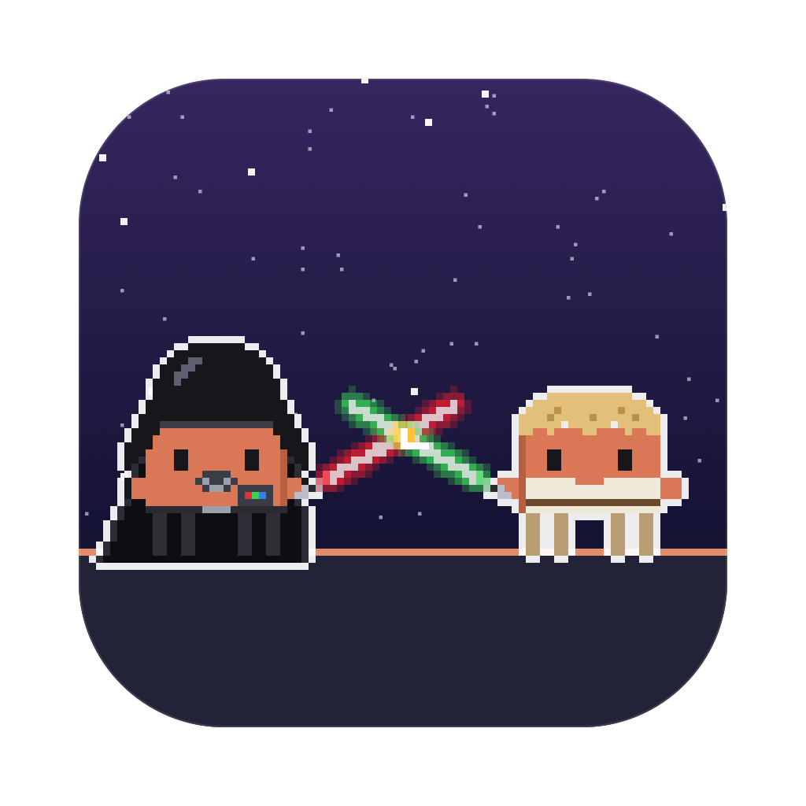
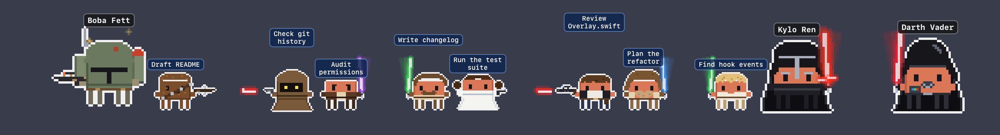
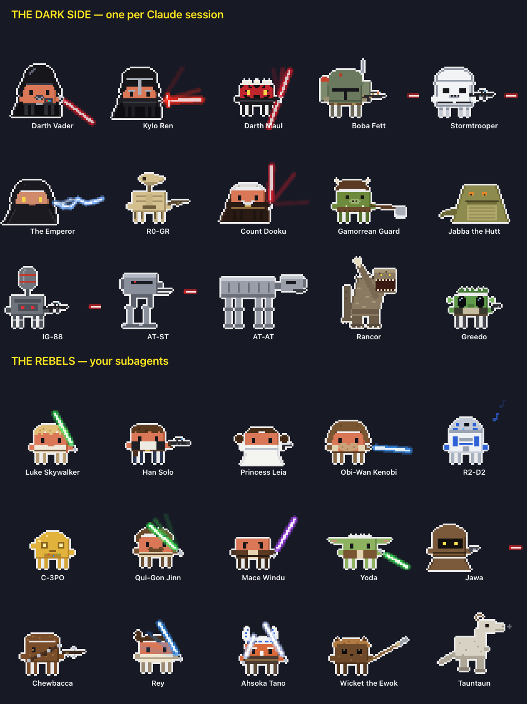
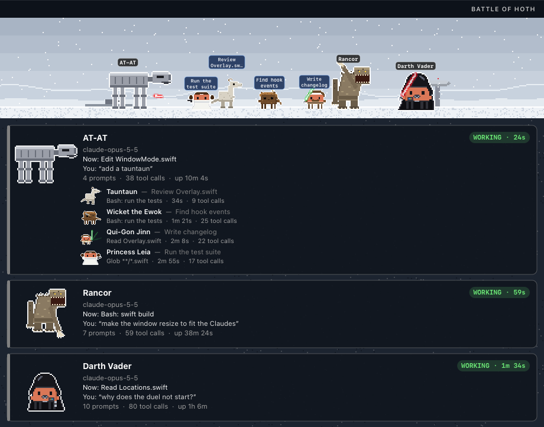
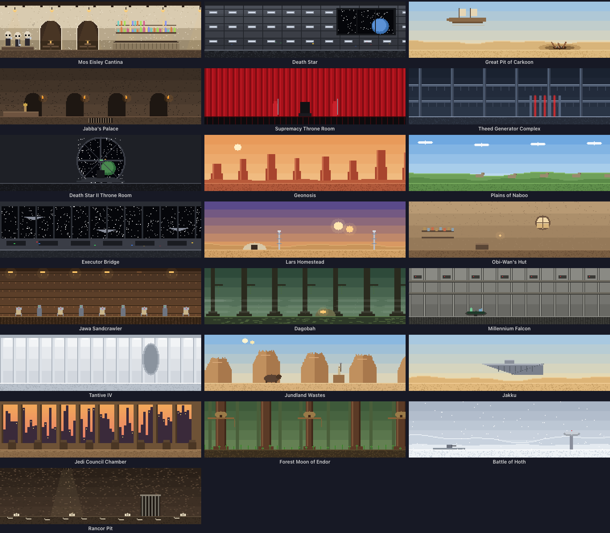

<p align="center">
  
</p>

<h1 align="center">Clawd Wars</h1>

<p align="center">
  <b>Your Claude Code sessions, as a pixel-art Star Wars battle on your desktop.</b><br>
  Every Claude is a villain. Every subagent is a Rebel. They fight while they work.
</p>

<p align="center">
  
</p>

---

## Why you want this

You run Claude Code in three terminals. One is thinking, one is waiting for your permission, one finished ten minutes ago and you didn't notice. You alt-tab around to find out.

**Clawd Wars tells you at a glance — without switching windows.**

- 🗡️ **Working?** Your Claude swings a lightsaber.
- 💭 **Thinking?** A thought bubble.
- ❗ **Needs you?** A red `!` — and if you ignore it for a minute, it starts jumping up and down.
- 😴 **Done and idle?** zZz.
- 🧑‍🚀 **Spawned subagents?** Rebels walk in next to it, each one labelled with *what it's doing* — and they fade out when they finish.
- 🖱️ **Click any of them** to jump straight to that session's terminal or VS Code tab.

It sits on the bottom of your screen, above every window, and it's click-through everywhere except the characters. No dashboard to open, no tab to check. It's just… there, quietly having a war.

And it's genuinely fun. Run two Claudes and they duel. Spawn a Han Solo and he shoots at Vader, who deflects every bolt into the sky. The Emperor catches Force lightning on Kylo's crossguard. Jabba laughs at all of it.

## The roster

Every character is Clawd — Claude Code's little pixel mascot — in costume, drawn in code: no sprite sheets, no image assets (even the app icon is rendered by the same code).

<p align="center">
  
</p>

**The dark side — one per Claude session**, picked at random (Vader and Kylo never spawn back to back): Darth Vader, Kylo Ren, Darth Maul, Boba Fett, a Stormtrooper, the Emperor, R0-GR the battle droid (*"Roger roger!"*), Count Dooku, a Gamorrean Guard, Jabba the Hutt (*"Ho ho ho!"*), IG-88, an AT-ST, an AT-AT, the Rancor and Greedo.

**The Rebels — your subagents**: Luke, Han, Leia, Obi-Wan, R2-D2, C-3PO, Qui-Gon, Mace Windu, Yoda, a Jawa, Chewbacca, Rey, Ahsoka, Wicket the Ewok and a tauntaun.

Blasters are drawn from the film props — Han's DL-44, Leia's Defender, the Stormtrooper's E-11, Boba's EE-3 — and so are the fights:

| Matchup | What happens |
|---|---|
| saber vs saber | they close in and duel; blades clash with sparks |
| blaster vs saber | bolts fly, the saber deflects each one off into the sky |
| Force lightning vs saber | the blade catches the lightning |
| lightning vs blaster | the gunner gets zapped |
| blaster vs blaster | shootout |
| odd one out | cheers the others on, with sparkles |

Claudes fight Claudes, agents fight agents, and leftovers pair up or cheer. R2-D2, C-3PO and the tauntaun stay out of it.

## Window mode

Prefer a window? **Show in Window** puts the whole crew in a scene and gives every Claude a card: what it's doing *right now*, your last prompt, its last reply, how long it's been at it, and every agent's task and current tool call.

<p align="center">
  
</p>

The scene is set **where the first Claude belongs** — the Death Star for Vader, the sarlacc pit for Boba, Jabba's palace, Hoth for the AT-AT:

<p align="center">
  
</p>

22 hand-built locations, each with its own little animation — the cantina band plays, the sarlacc's tentacles wave, Theed's laser gates pulse, snow falls on Hoth, fog drifts across Dagobah:

<p align="center">
  
</p>

The window sizes itself to the number of Claudes, has a themed title bar, can stay on top, and can hide its Dock icon.

## The little things

| You see | It means |
|---|---|
| lightsaber kata | Claude is running tools |
| 💭 thought bubble | thinking |
| red `!` | waiting for your permission — **jumping** after a minute |
| `?` | that session started before the hooks were installed; restart it for live status |
| zZz | idle for 5+ minutes |
| bobbing yellow ◆ | the Claude whose terminal you're looking at right now |
| matching label colours | a Claude and its agents share their project's colour |
| label above the head | the project (Claudes) or the task (agents) |

- **Several Claudes at once** — each gets its own villain and project label; sessions that predate the hooks are still found from the process table.
- **Drag** the crew anywhere — they'll stand right on the bottom edge of either monitor. Bubbles and labels never go off-screen; if the line is too long, everyone walks over to make room.
- **Click** a villain (or a card) to jump to the session: the exact tab in Terminal or iTerm2, or the right window — even the right *native tab* — in VS Code or Cursor.
- **Menu bar helmet** and right-click give you everything: status, Show in Window, Location, Settings. Hold **⌘** for the Playground (put any villains and heroes on stage and watch them fight) and Demo Mode.

## Install

Needs macOS 13+, Xcode Command Line Tools (`xcode-select --install`) and [Claude Code](https://claude.com/claude-code).

```sh
git clone https://github.com/rodclemen/clawd-wars.git
cd clawd-wars
./build.sh            # build, install "Clawd Wars.app" to ~/Applications, add the Claude Code hooks, launch
./build.sh --no-hooks # the same, but leave ~/.claude/settings.json alone
```

Claude Code sessions that were already running pick up the hooks after a restart (`/exit`, then `claude --continue`). Until then they still show up — as a villain with a `?`.

Clicking to jump to a session asks once for **Accessibility** permission.

## How it works

- A tiny Foundation-only binary, `vader-hook`, is registered in `~/.claude/settings.json` for Claude Code's hook events (session start/end, prompts, tool calls, permission requests, subagents, stop). It writes `~/.claude/vader-status/state.json` under a file lock and exits silently — it can never get in Claude's way.
- It records what each session is doing: its state and since when, the current tool call (`Edit Overlay.swift`, `Bash: swift build`), your last prompt and Claude's last reply, the model and session title, and each subagent's task.
- The app reads that twice a second, finds sessions without hooks from the process table, and drops a session the moment its process exits.
- Everything you see — characters, weapons, effects, 22 locations, the icon — is pixel art drawn in Swift at runtime. `Tools/RenderDocs` renders the roster and location sheets above; `CLAWD_SHOT=/path.png` makes the app dump its own frames.
- The first install backs up your settings to `~/.claude/settings.json.before-vader`.

## Uninstall

Menu bar helmet → **Settings → Remove Claude Code Hooks**, then **Quit**. Then:

```sh
rm -rf ~/Applications/"Clawd Wars.app" ~/.claude/vader-status
```

---

<p align="center"><sub>A fan project. Star Wars and its characters belong to Lucasfilm/Disney; Claude and Clawd belong to Anthropic.<br>Not affiliated with or endorsed by either.</sub></p>
