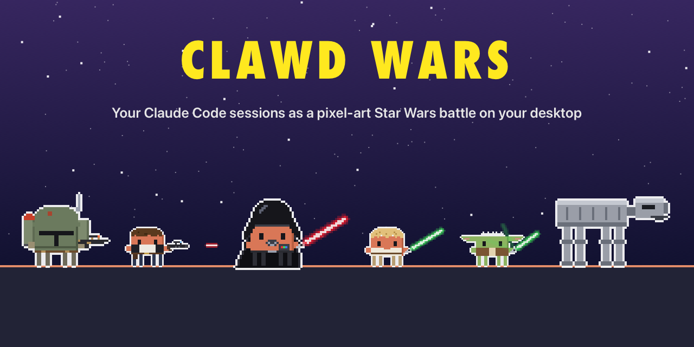
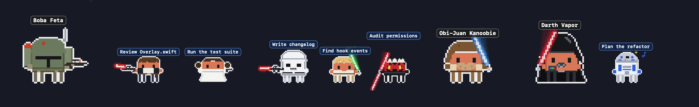
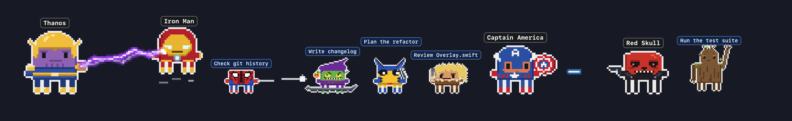
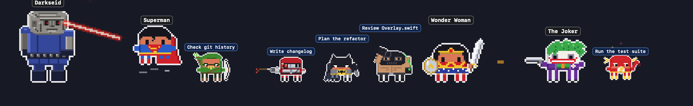
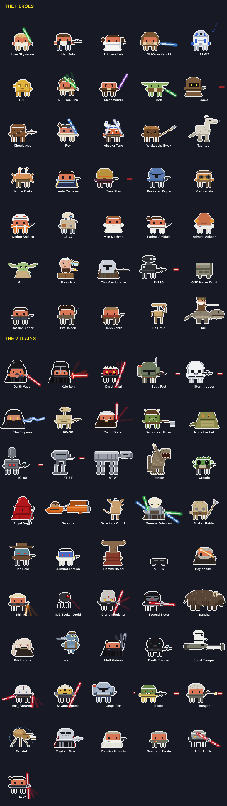
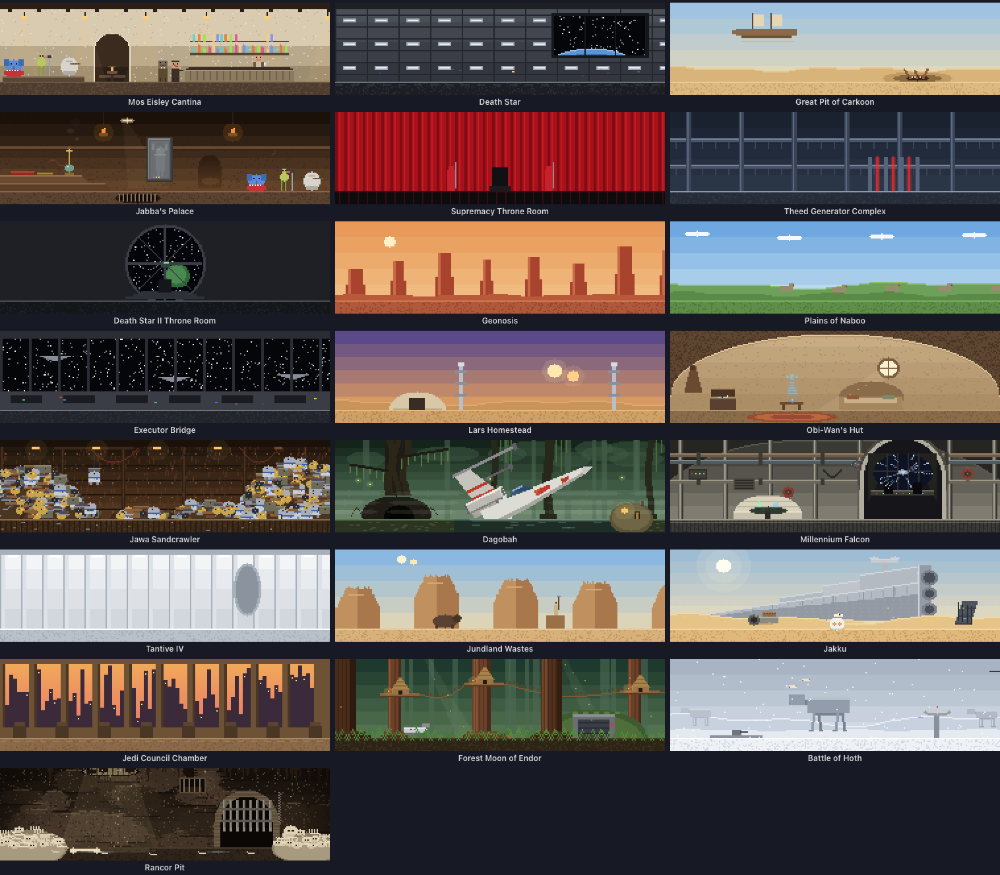
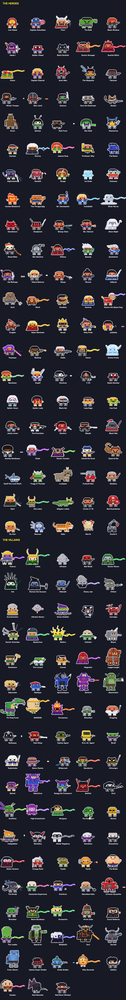
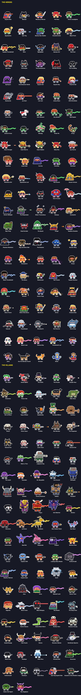
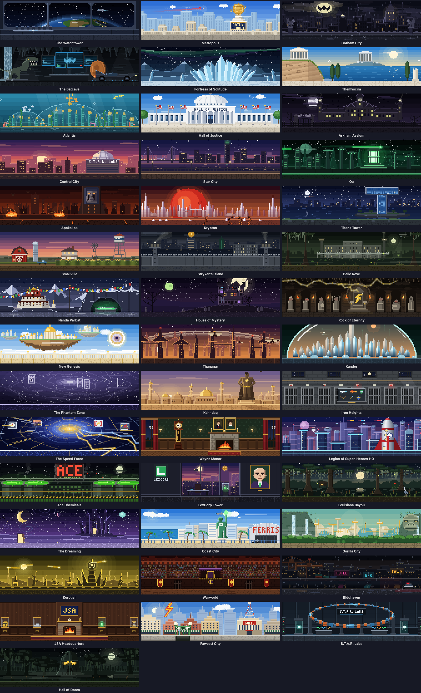

<p align="center">
  
</p>

<h1 align="center">Clawd Clash</h1>

<p align="center">
  <b>Your Claude Code, Codex, Qwen Code, Gemini CLI and GitHub Copilot CLI sessions, as a pixel-art Star Wars, Marvel or DC battle on your desktop.</b><br>
  Every session is a hero or a villain, every subagent joins in, and they fight while they work.
</p>

<p align="center">
  <a href="LICENSE"></a>
  
  
  
  
</p>

<p align="center">
  
</p>

Clawd Clash is one app with three universes: **Star Wars** (formerly [Clawd Wars](https://github.com/rodclemen/clawd-wars)), **Marvel** (formerly [Avengers: Clawd Wars](https://github.com/rodclemen/avengers-clawd-wars)) and **DC** (formerly [Justice League: Clawd Wars](https://github.com/rodclemen/justice-league-clawd-wars)). Pick one in Settings; a scene never mixes them. Those three pages show each universe on its own; this one is the app.

| Star Wars | Marvel | DC |
|---|---|---|
| https://github.com/user-attachments/assets/c0b65192-c2ae-4b2e-9c23-d50a2c157aef | https://github.com/user-attachments/assets/1f70859b-9230-4afb-9c8d-1121822be8e7 | https://github.com/user-attachments/assets/0396abbc-5ddd-4345-8e27-f33c2e79d616 |

<p align="center"><sub>🔊 Click the speaker in a player for sound: GitHub starts videos muted.</sub></p>

---

## Contents

- [What it does](#what-it-does)
- [Three universes](#three-universes)
- [Window mode and the screen saver](#window-mode-and-the-screen-saver)
- [The little things](#the-little-things)
- [Install](#install)
- [Coming from Clawd Wars, Avengers or Justice League](#coming-from-clawd-wars-avengers-or-justice-league)
- [How it works](#how-it-works)
- [Uninstall](#uninstall)
- [Contributing](#contributing)
- [License](#license)

## What it does

You run Claude Code in three terminals. One is thinking, one is waiting for your permission, one finished ten minutes ago and you didn't notice. Clawd Clash tells you at a glance, without switching windows.

- **Working?** Your Claude fights: a lightsaber, a shield, repulsors, heat vision, a spell.
- **Thinking?** A thought bubble.
- **Needs you?** A red `!`, and if you ignore it for a minute, it starts jumping up and down. It keeps asking until you answer; press Esc instead and it stands down.
- **Done and idle?** It stops fighting and passes the time with habits of its own, and most characters have a signature move (R2-D2 plays Leia's message, Han spins his blaster, Iron Man flips his faceplate up, Thanos snaps, Batman's batarang loops back to his hand). After a couple of minutes it sits down; after five it's asleep (zZz).
- **Spawned subagents?** They walk (or fly, or swing) in one by one, each labelled with what it's doing, and leave when they finish.
- **Hover** any character for the details; **click** it to jump straight to that session's terminal or editor tab.

<p align="center">
  <br>
  <br>
  
</p>

## Three universes

Choose in **Settings… → Universe**: **Star Wars**, **Marvel**, **DC** or **Random**. Switching recasts everyone on screen (each character becomes the one in the same place in the other cast, on the same side), moves the scene to one of the new universe's places, and changes the menu bar icon (Vader's helmet, Captain America's shield or Superman's S). In the window, the whole window changes over with the new universe's transition. **Random** switches on its own every 1, 5, 10, 15, 30 or 60 minutes.

| | Star Wars | Marvel | DC |
|---|---|---|---|
| Cast | 46 villains, 35 heroes | 88 villains, 105 heroes | 97 villains, 110 heroes |
| Places | 22, from the Mos Eisley cantina to Hoth | 43, from Avengers Tower to Ta Lo | 43, from the Watchtower to the Hall of Doom |
| Weapons | lightsabers, blasters, Force lightning | shields, hammers, claws, repulsors, webs, arrows, magic | fists, swords, heat vision, power rings, batarangs, arrows, magic |
| Set pieces | Han and Greedo face off, and Han shoots first; the Falcon picks Han up | arch-enemies face off first; the Quinjet and the Milano pick people up; flyers take to the air and fight from there | arch-enemies face off first; the Javelin and the Batwing pick people up; the Bat-family swings on grapnel lines |
| Sides | whoever came first keeps their side; Vader and Kylo never lead back to back | Claude Code plays the heroes when another AI runs | Claude Code plays the heroes when another AI runs |

<details>
<summary><b>The Star Wars cast and places</b></summary>
<p align="center"></p>
<p align="center"></p>
</details>

<details>
<summary><b>The Marvel cast and places</b></summary>
<p align="center"></p>
<p align="center"></p>
</details>

<details>
<summary><b>The DC cast and places</b></summary>
<p align="center"></p>
<p align="center"></p>
</details>

## Window mode and the screen saver

It opens in a window by default (switch to the desktop from the menu): the whole crew in a scene set where the first session's character belongs, with a card for every session: its project, what it's doing right now, your last prompt, its last reply, and its agents in a little tree.

<p align="center">
  
</p>

**The screen saver** (Settings… → Screen Saver → Install…) shows the place full screen with the crew fighting across its floor, a card per session, name tags, a clock and a crawl of what happened lately, and moves somewhere new every 10 minutes: with a Star Wars wipe, or in Marvel with a comic-book transition (halftone dots, a SNIKT!, BAMF!, THWIP! or KAPOW! for whoever's on screen, panels, speed lines, "MEANWHILE…", and with Deadpool about, Deadpool peeling the page off the screen or surfing past on a chimichanga), or in DC with one of fifteen of its own (the Flash racing through the Speed Force, the Bat-Signal, Superman bursting through the page, the Lasso of Truth, a Joker card, Darkseid's Omega Beams and more). Its **Options…** button in System Settings picks the universe: the same as the app, Star Wars, Marvel, DC, or Random (a new pick on each trip).

<p align="center">
  
</p>

## The little things

| You see | It means |
|---|---|
| fighting | Claude is running tools |
| 💭 thought bubble | thinking |
| red `!` | waiting for your permission, **jumping** after a minute |
| `?` | that session started before the hooks were installed; restart it for live status |
| sitting on the floor | idle for 2+ minutes |
| zZz | idle for 5+ minutes |
| bobbing yellow marker | the Claude whose terminal you're looking at right now |
| outline colour | which AI: Claude white, Claude desktop app coral, Codex cyan, Qwen lavender, Gemini gold, Copilot mint |

<p align="center">
  
</p>

- **Double-click the menu bar icon** to hide or show the crew; a single click opens the menu.
- **Keep Window on Top** (window mode) or **Keep Characters on Top** (desktop mode): off, the window behaves like any other, and the desktop crew lives on the desktop behind your windows.
- **Drag** the crew anywhere on either monitor.
- **Status Symbols** in the menu is this key, drawn with the app's own sprites.
- **Settings…** (⌘,) opens one window with every option: the universe, the window and the desktop, which AIs are connected, the screen saver, and Forget Idle Sessions.
- Hold **⌘** in the menu for the **Playground** (put anyone on stage and watch them fight) and Demo Mode.

## Install

Needs macOS 13+ (Apple Silicon or Intel) and at least one of [Claude Code](https://claude.com/claude-code), [Codex](https://developers.openai.com/codex), [Qwen Code](https://github.com/QwenLM/qwen-code), [Gemini CLI](https://github.com/google-gemini/gemini-cli) or [GitHub Copilot CLI](https://github.com/github/copilot-cli). Clawd Clash asks before connecting any of them, and only touches the ones you connect.

**With Homebrew:**

```sh
brew install --cask rodclemen/tap/clawd-clash
```

`rodclemen/tap/clawd-wars`, `rodclemen/tap/avengers-clawd-wars` and `rodclemen/tap/justice-league-clawd-wars` install the same app, starting in Star Wars, Marvel or DC. Or download the zip from [Releases](https://github.com/rodclemen/clawd-clash/releases), unzip it and drag **Clawd Clash** to Applications.

**From source** (no Xcode project, no packages, only Apple's free Command Line Tools):

```sh
xcode-select --install     # one time, if you don't have the developer tools
git clone https://github.com/rodclemen/clawd-clash.git && cd clawd-clash
./build.sh --no-install    # build and run the copy in build/: nothing installed, no AI's settings changed
./build.sh                 # build, install "Clawd Clash.app" to /Applications, refresh connected hooks, launch
```

Claude Code sessions that were already running pick up the hooks after a restart (`/exit`, then `claude --continue`). Until then they still show up, with a `?`.

> **Codex users:** Codex only runs hooks you've approved. After connecting it, run **`/hooks`** in Codex once and approve Clawd Clash.

Clicking to jump to a session in Terminal or iTerm2 asks once for **Automation** permission; jumping to VS Code or Cursor asks once for **Accessibility** permission.

## Coming from Clawd Wars, Avengers or Justice League

Clawd Clash replaces Clawd Wars, Avengers: Clawd Wars and Justice League: Clawd Wars. Through Homebrew, upgrading the `clawd-wars`, `avengers-clawd-wars` or `justice-league-clawd-wars` cask installs Clawd Clash in that universe. Installed by hand, it starts in the universe of the app it finds, and when it connects an AI it swaps the old app's hook for its own, so the old app can go. Star Wars keeps Clawd Wars' characters for sessions that are already running.

## How it works

- A tiny Foundation-only binary, `clawd-clash-hook`, is registered for each connected AI's hook events (session start/end, prompts, tool calls, permission requests, subagents, stop). It writes `~/.claude/clawd-clash/state.json` under a file lock and exits silently, so it can never get in Claude's way. It casts new characters from the universe on show.
- The app reads that twice a second, finds sessions without hooks from the process table, and drops a session the moment its process exits.
- Everything you see (481 characters, their weapons and effects, 108 places, the ships, the icon) is pixel art drawn in Swift at runtime. The whole app is about 10 MB; only the characters and the place on screen are ever drawn.

## Uninstall

With Homebrew: `brew uninstall --cask clawd-clash` (add `--zap` to also remove its settings and status file). Otherwise: menu bar icon → **Settings…** → **Remove** beside each connected AI, then **Quit**, or from the terminal:

```sh
"/Applications/Clawd Clash.app/Contents/MacOS/ClawdClash" --uninstall-hooks
rm -rf "/Applications/Clawd Clash.app" ~/.claude/clawd-clash
```

## Contributing

Each universe lives in its own folder, `Sources/App/Universes/StarWars`, `.../Marvel` and `.../DC`:

- **A character** is a `Persona` (name, weapon, how it moves, what its shots or magic look like, its signature move) registered next to its drawing function in the universe's `Art/*.swift` files. Add its case at the **end** of the universe's hero or villain enum (ids are saved, so never reorder), give it a home in the roster file, and bump the count in `Sources/Shared/Universe.swift`. `Sources/App/Pose.swift` explains what a drawing function gets and must do.
- **A place** is a `Place` in the universe's `Places/` files: a still picture and an optional moving layer.
- **A whole universe** is a `Theme` (`Sources/App/Theme.swift`): its cast, places, homes, arch-enemies, ships, menu bar icon. Add a case to `Universe` and a theme folder.
- **Check it** with `Tools/Preview/build.sh`, then `build/preview cast out.png vader thor` (every pose), `build/preview fight out.png luke vader`, `build/preview place out.png cantina asgard`. `Tools/RenderDocs` renders this page's sheets, `Tools/MakeIcon` the icon.

## License

**Free to use.** The code is [MIT licensed](LICENSE): use it, change it, share it, just keep the license notice.

---

<p align="center"><sub>A fan project. Star Wars belongs to Lucasfilm/Disney, Marvel to Marvel/Disney, DC to DC Comics/Warner Bros.; Claude and Clawd belong to Anthropic.<br>Not affiliated with or endorsed by any of them.</sub></p>
