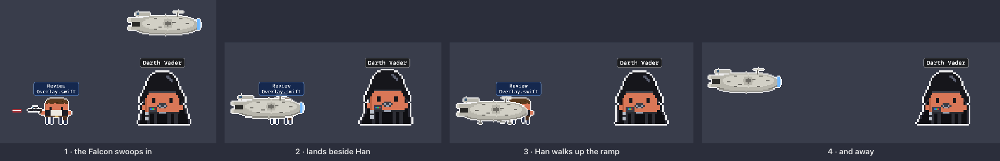

<p align="center">
  
</p>

<h1 align="center">Clawd Wars</h1>

<p align="center">
  <b>Your Claude Code, Codex, Qwen Code, Gemini CLI and Copilot CLI sessions, as a pixel-art Star Wars battle on your desktop.</b><br>
  Every session is a hero or a villain, every subagent joins in, and they fight while they work.
</p>

<p align="center">
  <a href="LICENSE"></a>
  
  
  
  
</p>

<p align="center">
  
</p>

---

## Why you want this

You run Claude Code in three terminals. One is thinking, one is waiting for your permission, one finished ten minutes ago and you didn't notice. You alt-tab around to find out.

**Clawd Wars tells you at a glance — without switching windows.**

- 🗡️ **Working?** Your Claude swings a lightsaber.
- 💭 **Thinking?** A thought bubble.
- ❗ **Needs you?** A red `!` — and if you ignore it for a minute, it starts jumping up and down.
- 😴 **Done and idle?** After a couple of minutes it sits down; after five it's asleep (zZz).
- 🧑‍🚀 **Spawned subagents?** Rebels march in one by one, each labelled with *what it's doing* — and they leave when they finish. (When Han's done, the Millennium Falcon lands, he walks up the ramp, and it flies off.)
- 🔍 **Want details?** Hover any character: status, how long, the tool it's running right now, your last prompt.
- 🖱️ **Click any of them** to jump straight to that session's terminal or VS Code tab.

It sits on the bottom of your screen, above every window, and it's click-through everywhere except the characters. No dashboard to open, no tab to check. It's just… there, quietly having a war.

And it's genuinely fun. Run two Claudes and they duel. Spawn a Han Solo and he shoots at Vader, who deflects every bolt into the sky. The Emperor catches Force lightning on Kylo's crossguard. Jabba laughs at all of it.

## Claude vs Codex vs everyone

Run **Claude Code** alongside **OpenAI Codex**, **Qwen Code**, **Gemini CLI** or **GitHub Copilot CLI** and they pick sides: whichever was there first keeps its side, the other takes the opposite — Claude has Vader, so Codex gets the heroes — and each one's agents fight for their own side. Light side versus dark side, literally. Close one and everyone's random again.

You can tell the AIs apart at a glance: Claude's characters keep the white outline; Codex gets cyan, Qwen Code lavender, Gemini CLI gold and Copilot CLI mint. In the window and the menu bar list, each AI gets its own little section, and Claude Code sessions running inside the **Claude desktop app** are listed separately from the ones in your terminal, with a coral outline instead of white (VS Code ones say so too).

## The roster

Every character is Clawd — Claude Code's little pixel mascot — in costume, drawn in code: no sprite sheets, no image assets (even the app icon is rendered by the same code).

<p align="center">
  
</p>

Anyone can be a session (drawn large) or an agent (drawn small). **The dark side** (Vader and Kylo never spawn back to back): Darth Vader, Kylo Ren, Darth Maul, Boba Fett, a Stormtrooper, the Emperor, R0-GR the battle droid (*"Roger roger!"*), Count Dooku, a Gamorrean Guard, Jabba the Hutt (*"Ho ho ho!"*), IG-88, an AT-ST, an AT-AT, the Rancor and Greedo.

**The light side**: Luke, Han, Leia, Obi-Wan, R2-D2, C-3PO, Qui-Gon, Mace Windu, Yoda, a Jawa, Chewbacca, Rey, Ahsoka, Wicket the Ewok and a tauntaun.

Blasters are drawn from the film props — Han's DL-44, Leia's Defender, the Stormtrooper's E-11, Boba's EE-3 — and so are the fights:

| Matchup | What happens |
|---|---|
| saber vs saber | they close in and duel; blades clash with sparks |
| blaster vs saber | bolts fly, the saber deflects each one off into the sky |
| Force lightning vs saber | the blade catches the lightning |
| lightning vs blaster | the gunner gets zapped |
| blaster vs blaster | shootout |
| odd one out | cheers the others on, with sparkles |

Claudes fight Claudes, agents fight agents, and leftovers pair up or cheer. R2-D2, C-3PO and the tauntaun stay out of it.

And when Han Solo's agent is done, he doesn't just fade away — the Millennium Falcon comes to pick him up:

<p align="center">
  
</p>

## Window mode

Prefer a window? **Show in Window** puts the whole crew in a scene and gives every Claude a card: what it's doing *right now*, your last prompt, its last reply, how long it's been at it, and every agent's task and current tool call.

<p align="center">
  
</p>

The scene is set **where the first Claude belongs** — the Death Star for Vader, the sarlacc pit for Boba, Jabba's palace, Hoth for the AT-AT:

<p align="center">
  
</p>

22 hand-built locations, each with its own little animation — Figrin D'an and the Modal Nodes (or, some nights, the Max Rebo Band) play in the cantina while Wuher polishes glasses and Dr. Evazan looks for trouble at the bar, the Max Rebo Band plays for Jabba, the sarlacc's tentacles wave, Theed's laser gates pulse, snow falls on Hoth, fog drifts across Dagobah:

<p align="center">
  
</p>

The window sizes itself to the number of sessions (or keep your own height), can hide the session list to become just the scene strip (the collapse button in its title bar), has a themed title bar with its own close and minimize buttons, can stay on top, and can hide its Dock icon. Project names float over the Claudes on the desktop; in the window the cards carry them instead — each mode remembers your choice.

## The little things

Hover over anyone for the details — what that session is doing right now, your last prompt, its agents (on the desktop, or in the window when its session list is hidden):

<p align="center">
  
</p>

| You see | It means |
|---|---|
| lightsaber kata | Claude is running tools |
| 💭 thought bubble | thinking |
| red `!` | waiting for your permission — **jumping** after a minute |
| `?` | that session started before the hooks were installed; restart it for live status |
| sitting on the floor | idle for 2+ minutes |
| zZz | idle for 5+ minutes |
| `?` and NOT REPORTING | the hooks stopped reporting for that session while it's clearly busy — restart it |
| `?` and APPROVE IN /hooks | a Codex session is working but its hook hasn't been approved yet — type `/hooks` in Codex and approve Clawd Wars |
| banner + ⚠︎ menu item | an AI on your Mac isn't connected, or one of its sessions isn't reporting; the menu item fixes it (connect, or jump to the session) |
| red OFFLINE banner | the status file can't be read — never silently stale |
| bobbing yellow ◆ | the Claude whose terminal you're looking at right now |
| matching label colours | a Claude and its agents share their project's colour |
| label above the head | the project (Claudes) or the task (agents) |

- **Several Claudes at once** — each gets its own villain and project label; sessions that predate the hooks are still found from the process table.
- **Hover** any villain or agent for a details card; agents also show which Claude they work for.
- **Newcomers walk in** from the side of the screen, one at a time, instead of popping up.
- **Drag** the crew anywhere — they'll stand right on the bottom edge of either monitor. Bubbles and labels never go off-screen; if the line is too long, everyone walks over to make room.
- **Click** a villain (or a card) to jump to the session: the exact tab in Terminal or iTerm2, or the right window — even the right *native tab* — in VS Code or Cursor.
- **Menu bar helmet** and right-click give you everything: status, Show in Window, Location, Settings. Hold **⌘** for the Playground (put any villains and heroes on stage and watch them fight) and Demo Mode.

## Install

Needs macOS 13+ (Apple Silicon or Intel) and at least one of [Claude Code](https://claude.com/claude-code), [Codex](https://developers.openai.com/codex) [Qwen Code](https://github.com/QwenLM/qwen-code), [Gemini CLI](https://github.com/google-gemini/gemini-cli) or [GitHub Copilot CLI](https://github.com/github/copilot-cli). Hooks are added for every one of them installed on your Mac (`~/.claude/settings.json`, `~/.codex/hooks.json`, `~/.qwen/settings.json`, `~/.gemini/settings.json`, `~/.copilot/hooks/clawd-wars.json`).

> Google's newer **Antigravity CLI** (`agy`) isn't supported yet: its hooks have to answer some events with decisions, which needs testing against a real install first.

> **Codex users:** Codex only runs hooks you've approved. After installing, run **`/hooks`** in Codex once and approve the Clawd Wars hook — until then your Codex sessions still show up, but with a `?` instead of live status. You don't have to remember: when a Codex session starts working without reporting, Clawd Wars sends a notification telling you to approve it (click it to jump to that session).

Clawd Wars only checks the AIs actually on your Mac. If one is installed but not connected (say you install Codex later), you get a banner and a **⚠︎ Connect Codex…** item at the top of the menu, and the app offers to connect it on next launch.

**With Homebrew** (easiest):

```sh
brew install --cask rodclemen/tap/clawd-wars
```

Or download the zip from [Releases](https://github.com/rodclemen/clawd-wars/releases), unzip it and drag **Clawd Wars** to Applications. On first launch it offers to connect every supported AI it finds — Claude Code, Codex, Qwen Code, Gemini CLI, Copilot CLI — adding a small hook to each one's settings and keeping a backup.

**From source** (needs Xcode Command Line Tools — `xcode-select --install`):

```sh
git clone https://github.com/rodclemen/clawd-wars.git
cd clawd-wars
./build.sh            # build, install "Clawd Wars.app" to ~/Applications, add the Claude Code hooks, launch
./build.sh --no-hooks # the same, but leave ~/.claude/settings.json alone
```

Claude Code sessions that were already running pick up the hooks after a restart (`/exit`, then `claude --continue`). Until then they still show up — as a villain with a `?`.

Clicking to jump to a session asks once for **Accessibility** permission.

## How it works

- A tiny Foundation-only binary, `vader-hook`, is registered in `~/.claude/settings.json` for Claude Code's hook events (session start/end, prompts, tool calls, permission requests, subagents, stop). It writes `~/.claude/vader-status/state.json` under a file lock and exits silently — it can never get in Claude's way.
- It records what each session is doing: its state and since when, the current tool call (`Edit Overlay.swift`, `Bash: swift build`), your last prompt and Claude's last reply, the model and session title, and each subagent's task.
- The app reads that twice a second, finds sessions without hooks from the process table, and drops a session the moment its process exits.
- Everything you see — characters, weapons, effects, 22 locations, the icon — is pixel art drawn in Swift at runtime. `Tools/RenderDocs` renders the roster and location sheets above; `CLAWD_SHOT=/path.png` makes the app dump its own frames.
- The first install backs up your settings to `~/.claude/settings.json.before-vader`.

## Uninstall

With Homebrew: `brew uninstall --cask clawd-wars` (removes the hooks too; add `--zap` to also remove its settings and status file).

Otherwise: menu bar helmet → **Settings → Remove Claude Code Hooks**, then **Quit**. Then:

```sh
rm -rf ~/Applications/"Clawd Wars.app" ~/.claude/vader-status
```

## Contributing

New characters and locations are very welcome — everything is pixel art drawn in code, so there are no assets to wrangle:

- **A villain:** add a case to `Leader` in `Sources/App/Leaders.swift` (name, weapon, head height) and a `draw…` costume function; give it a home in `Location.home(of:)`.
- **A hero:** add a case to `Companion` in `Sources/App/Characters.swift` and its drawing; a home in `Location.home(of:)`.
- **A location:** add a case to `Location` and a scene in `Scenes` (`Sources/App/Locations.swift`), with an optional animated layer.
- Bump `leaderCount` / `companionCount` in `Sources/Shared/StatusStore.swift`.
- Check it: hold ⌘ and open the menu for the **Playground**, or run `CLAWD_SHOT=/tmp/shot.png` with `--playground=…` / `--agents=…`. Regenerate the README sheets with `Tools/RenderDocs`.

Issues and pull requests are open — say which character you'd like next.

## License

**Free to use.** The code is [MIT licensed](LICENSE): use it, change it, share it, ship it — just keep the license notice.

---

<p align="center"><sub>A fan project. Star Wars and its characters belong to Lucasfilm/Disney; Claude and Clawd belong to Anthropic.<br>Not affiliated with or endorsed by either.</sub></p>
